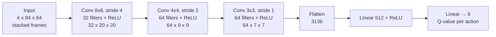
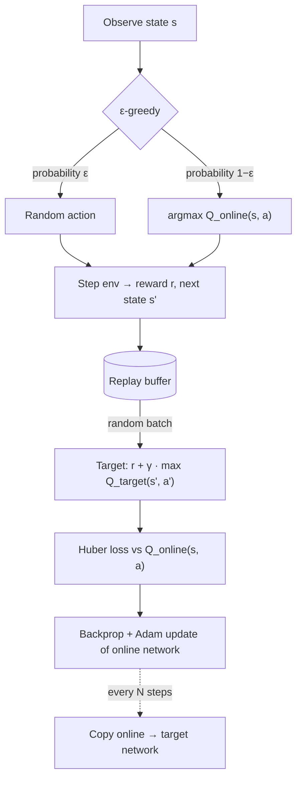
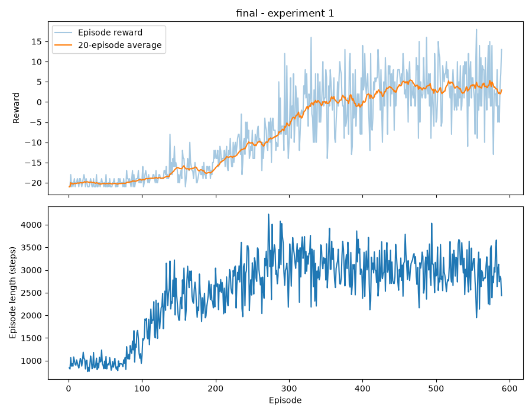

# Deep Q-Network Agent for Atari Pong

## Project Introduction

We implemented a Deep Q-Network (DQN) agent from scratch with PyTorch and Gymnasium, and trained it to play **Pong** (`ALE/Pong-v5`). We did not use any ready-made RL library (no Stable-Baselines3, RLlib, CleanRL or TorchRL).

**Game objective:** the agent controls the right paddle and must hit the ball past the opponent's paddle. Each point scored gives +1, each point conceded gives −1, and a game ends when one side reaches 21. Episode rewards therefore range from −21 (lost every point) to +21 (won every point).

## Group Members

| Name | Role / contribution |
|------|---------------------|
| Jolly Gift Burabyo | Experiment setup and batch runner (`experiments.csv`, `run_experiments.py`), learning-rate and batch-size experiments, README, task allocation sheet, repo config; ran all training on Jolly's machine |
| Dan Paul Dushime | DQN implementation (`train.py`, `play.py`), uv project setup (`pyproject.toml`, `uv.lock`), gamma experiments |
| Thierry Alain Tresor Ibyishaka | Epsilon (exploration) experiments, final model (`dqn_model.pth`, `models/final/`), gameplay video (`record_video.py`, `gameplay.mp4`) |

See `Task allocation sheet.pdf` for the full task allocation.

## Setup

This project uses [uv](https://docs.astral.sh/uv/) to manage packages.

```bash
uv sync
```

## How to run

Train one experiment (results go to `models/<member>/exp_<N>/`):

```bash
uv run train.py --member alice --exp 1 --lr 1e-4 --gamma 0.99 --batch-size 32 --eps-start 1.0 --eps-end 0.05 --eps-decay 100000 --total-steps 300000
```

Watch the best agent play (it loads `dqn_model.pth` by default):

```bash
uv run play.py
```

## DQN Architecture

### Q-Network

The input is the last 4 game frames, each converted to 84×84 grayscale and stacked. The network outputs one Q-value per action (Pong has 6 actions).



### Training loop



### Explanation of the training process

1. **Environment:** Pong with frame skipping (every action is repeated for 4 frames), grayscale 84×84 frames, and a stack of the last 4 frames so the agent can see the ball's direction.
2. **Online and target networks:** two copies of the same CNN. The online network is trained every few steps. The target network is a frozen copy, refreshed every `--target-update` steps, which gives stable learning targets.
3. **Experience replay:** each transition `(s, a, r, s', done)` goes into a circular buffer. Training batches are sampled at random, which breaks the correlation between consecutive frames.
4. **ε-greedy exploration:** with probability ε the agent takes a random action, otherwise it takes the action with the highest Q-value. ε decays linearly from `eps_start` to `eps_end` over `eps_decay` steps.
5. **Bellman target and loss:** `target = r + γ · max_a' Q_target(s', a')`, with no future term when the game is over. The loss is the Huber (smooth L1) loss between `Q_online(s, a)` and the target.
6. **Optimisation:** backpropagation with Adam, using gradient clipping (max norm 10) for stability.
7. **Logging:** every episode's length, total steps, reward and ε are saved to `training_log.csv` and plotted to `training_plot.png`.

## Hyperparameter Experiments

Each member ran 10 experiments, each with a different combination of hyperparameters. The results are in:

- [Jolly_Gift_Burabyo_Hyperparameter_experiment_results.md](Jolly_Gift_Burabyo_Hyperparameter_experiment_results.md) (focus: learning rate and batch size)
- [Dan_Paul_Dushime_Hyperparameter_experiment_results.md](Dan_Paul_Dushime_Hyperparameter_experiment_results.md) (focus: gamma)
- [Thierry_Alain_Tresor_Ibyishaka_Hyperparameter_experiment_results.md](Thierry_Alain_Tresor_Ibyishaka_Hyperparameter_experiment_results.md) (focus: epsilon schedule)

All 30 runs are listed in `experiments.csv` and can be run in one go with `uv run run_experiments.py`. Every run used 500,000 environment steps. The training runs were executed on Jolly's machine because the other members' laptops were too slow. Each member is responsible for analysing and presenting their own 10 runs.

Each experiment's model, log and plot are in `models/<member>/exp_<N>/`.

### Best configuration

The best of the 30 experiments was Jolly's experiment 7 (batch size 128). We retrained those settings for 1.5 million steps to produce the final model, `dqn_model.pth` (all files in `models/final/exp_01/`).

| Learning rate | Gamma | Batch size | ε start | ε end | ε decay | Total steps | Mean reward (last 20 episodes) | Best episode |
|---|---|---|---|---|---|---|---|---|
| 0.0001 | 0.99 | 128 | 1.0 | 0.05 | 100,000 | 1,500,000 | +3.0 | +18 |

Over training, the agent went from losing every point (−21) to beating the built-in opponent on average. It won 187 of its 589 training games. Games also got much longer (from about 800 to about 2,900 steps) as the agent learned to return the ball.

### Summary of all 30 experiments

| Finding | Evidence |
|---|---|
| Learning rate had the biggest effect | Every run with lr ≥ 0.00025 and γ ≥ 0.95 stayed at about −21 (no learning); lr 0.0001 and below learned |
| Larger batches helped | With lr 0.0001: batch 16 → −20.4, 32 → −17.4, 64 → −10.2, 128 → −9.9 |
| A lower gamma made a high learning rate less unstable | At lr 0.00025, only γ = 0.9 learned noticeably (−16.8) |
| Decaying epsilon too fast hurt | Decay over 25k steps → −19.0; over 200k steps → −13.4 |



## Gameplay Demonstration

[▶ Watch the gameplay video on Google Drive](https://drive.google.com/file/d/1U2E0e0BwUbfvM9IYHBTt13R1AzKi9XiI/view?usp=sharing) (also in this repo as [gameplay.mp4](gameplay.mp4)): one full game played by the final model with greedy actions. The agent is the green paddle on the right and wins **21–14**.

To watch it live:

```bash
uv run play.py
```

To record a new video: `uv run record_video.py`

## Notes

- On macOS you may see `Class SDL_... is implemented in both ...` warnings when running `play.py`. OpenCV and the Atari emulator each bundle the SDL library. The warning did not affect any of our runs.
